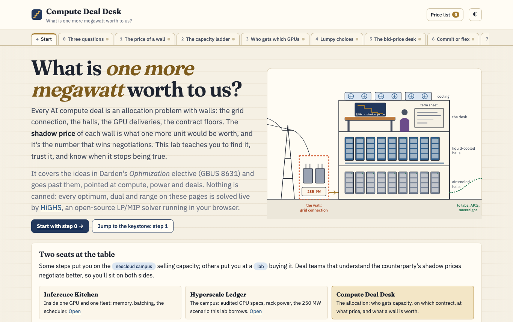

# Compute Deal Desk

**What is one more megawatt worth to us?** A hands-on lab for allocating and pricing scarce AI compute: shadow prices of power and GPUs, take-or-pay vs “up to,” site portfolios, bid prices and the capstone memo you'd take into the room. Every optimum, shadow price and allowable range is solved live in your browser by a real LP/MIP solver ([HiGHS](https://highs.dev), compiled to WebAssembly), and every model has a Python twin.

**Play it: https://bakulbadwal.github.io/compute-deal-desk/**

<picture>
  <source media="(prefers-color-scheme: dark)" srcset="docs/hero-dark.png">
  
</picture>

Every compute deal is an allocation problem with walls: the grid connection, the liquid-cooled halls, the GPU deliveries, the take-or-pay floors. Solve it and you get a plan. You also get a **price for every wall**, what one more unit would be worth, and the range over which that price holds. That number, the *shadow price*, is the most useful sentence in a capacity negotiation, and this lab teaches you to find it, trust it, and know when it stops being true.

It covers the ideas in a business-school optimization elective (formulation, sensitivity analysis, multiperiod, matching, integer and stochastic programming, nonlinear allocation, and working with GenAI on models) and goes further, pointed at compute, power and AI deals. Some steps seat you at a **neocloud** selling capacity; others at a **lab** buying it.

## What's inside

| Step | You play with | What clicks |
|---|---|---|
| **0 · Three questions** | A 250 MW campus split between a training lease and an inference cloud, drawn as a floor plan you can see | Decisions, objective, walls. The plan sits on a corner, and the binding walls are the story |
| **1 · The price of a wall** ★ | Six products, five physical walls. Nudge any wall; read a live **Excel-layout sensitivity report**; switch on four offers to relax the grid (substation, cooling retrofit, gas turbines, flexible load) | The grid is worth $3.48M per MW-year, *for the next 15.2 MW*. Then GPU deliveries bind and the price collapses, so 40 MW is worth ~$56M a year, not 40 × $3.48M. The solver buys relief exactly up to where the staircase meets the supply curve |
| **2 · The capacity ladder** | Twelve quarters of build (6-quarter lead), lease (2-quarter lead, 8-quarter tranches) and spot, under a board-signed take-or-pay floor | Lead times set the marginal price of capacity. The floor has a price you can quote. Every finite plan lies at its end |
| **3 · Who gets which GPUs** | Teams to clusters (integral for free), then jobs with sizes on clusters with capacity (not), then a cost–latency frontier | Total unimodularity, and where it ends. Bring the frontier, not a weight |
| **4 · Lumpy choices** | A 237 MW site portfolio with either/or rules; a branch-and-bound tree you step through; jobs packed into 72-GPU NVLink racks | The relaxation is a bound. The MIP gap is the honest stopping rule. First-fit packing strands a ~$3M rack the exact solve doesn't |
| **5 · The bid-price desk** | Four weeks of spare racks, eight products, a seeded stream of booking requests | The bid price is a shadow price from the seller's side. Saying no to cheap early bookings beats first-come-first-served by ~17% |
| **6 · Commit or flex** | Twenty demand scenarios; take-or-pay, an “up to” and thin spot; WS / RP / EEV; a CVaR dial | Commit to the critical fractile, not the forecast. A deterministic plan never buys an option. The “up to” is worth $4.75M per MW-year to this buyer (~$0.90 per GPU-hour) |
| **7 · Diminishing returns** | Split compute across four research bets; Chinchilla solved as a Lagrangian with three published fits | Equal marginal returns, and λ is the shadow price of compute. The tokens-per-parameter rule moves from ~62 to ~98 to ~18 depending on the fit |
| **8 · The modeler's desk** | Four AI-written formulations of one problem (three quietly wrong) and a verifier; OptiGuide-style what-ifs; “spot the LP” | AI's optimization bugs solve to “optimal.” Audit, hand-solve a toy, test big-M reachability, check dual signs |
| **★ The allocation memo** | Six quarters, five demand futures, four contract types, one power cap. Build your plan, get scored against the solver, read its price list, draft the six-sentence memo | You can make the call and defend it |
| **✓ Field test** | Ten questions answered by operating the widgets | Proof it stuck |

Each step has a predict-then-reveal question, a “say it out loud” line, a model card (the formulation in words, the live LP the solver sees, the Python twin and the Excel Solver equivalent), and a running **price list** of every shadow price you've uncovered, in deal language, printable as a one-pager.

## What's exact and what's a teaching model

- **Exact:** every optimum, dual, reduced cost, RHS and cost range, MIP gap, branch-and-bound node and stochastic metric (WS, RP, EEV, VSS, EVPI, CVaR) is computed at run time by HiGHS 1.15 ([highs-js](https://github.com/lovasoa/highs-js) 1.15.3). Ranging uses a simplex basis with presolve off. MIP “shadow prices” are labelled as fixed-integer LP duals, because MIPs have none.
- **Sourced:** rack power (120 kW per GB200 NVL72), rack cost ($3.0M), GPU life (5 years), PUE (1.14), power price ($0.0834/kWh), the 250 MW campus and B200 dense BF16 throughput come from the audited [Hyperscale Ledger](https://github.com/bakulbadwal/hyperscale-ledger). Contract shapes (take-or-pay vs “up to,” 2–6-year tranches, the 20–30 MW site pivot) come from public deal reporting. The Chinchilla fits are Hoffmann et al. 2022 (arXiv 2203.15556), unrounded and as printed, and Besiroglu et al. 2024 (arXiv 2404.10102).
- **Teaching values:** every $/GPU-hour price, margin, demand curve and booking stream. Per-deal compute pricing isn't public, so every dollar shadow price on the page carries an “at teaching prices” tag. **Quote the ratios and the mechanics, not the dollars.**
- **Not used:** no case data from any course. The lab borrows each session's *problem type*, never its numbers or text.

## The Python track

[`models/`](models/) re-states every step's model in ~30–80 lines of Python with `highspy` (the course, in code instead of Excel). [`models/README.md`](models/README.md) has a Solver ↔ code translation table, including how each Sensitivity Report column maps to duals, reduced costs and ranging.

```bash
python3 -m venv .venv && .venv/bin/pip install -r models/requirements.txt
.venv/bin/python models/s1_price_of_a_wall.py
```

## Checks

`make check` is the acceptance gate (235 checks at the last run). It solves every browser model in Node and its Python twin, and compares objectives, duals, reduced costs, ranges and stochastic metrics to 1e-6. It also:

- finite-differences every binding dual and flags degenerate rows (the step-2 take-or-pay floor is degenerate, so the page quotes one-sided prices by re-solving instead of a single dual);
- runs null cases (no binding wall ⇒ all duals 0; no uncertainty ⇒ VSS = EVPI = 0; identical bets ⇒ an equal split; pure assignment ⇒ an integral LP);
- runs the step-5 booking simulation over three batches of 40 seeds and checks the bid-price policy wins in every batch.

`make smoke` loads every route in headless Chrome and fails on any error. [`ACCEPTANCE.md`](ACCEPTANCE.md) lists what's checked and the numbers the copy quotes.

```bash
make check      # Node + Python
make serve      # http://localhost:8817 (ES modules + WebAssembly need http://, not file://)
make smoke      # with the server running
```

## Run it

Play it live at the link above, or clone and run `python3 tools/serve.py`. It's a static site: no build step and no framework. The solver (~3.5 MB of WebAssembly) is vendored in `js/vendor/`.

## Files

| Path | Role |
|---|---|
| `index.html`, `css/style.css` | Shell and the design system (paper, navy ink, brass for prices, signal orange for walls; light and dark) |
| `js/lp.js` | A small modeling layer over HiGHS: variables, rows, `solve({ ranging, relax, overrides })`, LP text for the model cards, finite-difference duals |
| `js/econ.js` | Unit economics from the Hyperscale Ledger (600 GPUs per MW, $25M capex per MW, power and opex per MW-year) |
| `js/models.js` | Every step's model builder and default data: pure functions, shared by the page and the tests |
| `js/steps/*.js` | One module per step: the widgets, charts and copy |
| `js/app.js`, `js/ui.js`, `js/art.js` | Router, price list, progress; the DOM/SVG toolkit; the campus cutaway |
| `models/` | The Python twins (`highspy`) |
| `tests/check.mjs` | The acceptance checker |
| `tools/serve.py`, `tools/smoke.sh` | Local no-cache server; headless smoke test |
| [`CASE_STUDY.md`](CASE_STUDY.md) | Why this exists and the product decisions behind it |

## Siblings

- [Inference Kitchen](https://github.com/bakulbadwal/inference-kitchen): inside one GPU and one fleet (memory, batching, the scheduler, fleet economics).
- [Hyperscale Ledger](https://github.com/bakulbadwal/hyperscale-ledger): the campus (audited GPU specs, rack power, a 250 MW scenario, *Below the rack*).
- Compute Deal Desk: the allocation (who gets capacity, on which contract, at what price, and what a wall is worth).

Built by [Bakul Badwal](https://github.com/bakulbadwal) (UVA Darden MBA '27) with Claude Code.

## License

MIT. HiGHS and highs-js are MIT-licensed (see `js/vendor/HIGHS-JS-LICENSE`).
